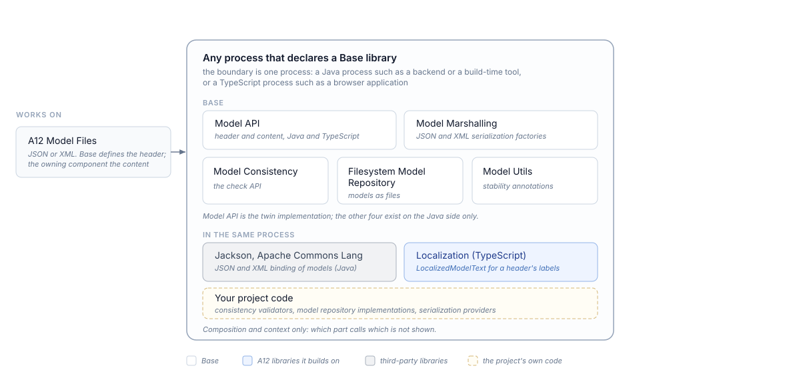

////
SPDX-License-Identifier: EUPL-1.2 OR LicenseRef-commercial

Copyright (c) 2012-2026 mgm technology partners GmbH

Dual License
------------
This source file is part of the mgm A12 Platform and available under
a choice of two different licenses:

1. Open-Source License - EUPL v1.2
   You may redistribute and/or modify this file under the terms of the
   European Union Public License, version 1.2 - see https://eupl.eu/.

2. Commercial License
   Alternatively, you may obtain a commercial license from
   mgm technology partners GmbH, that permits use of this software
   under different terms (including support and maintenance services).

   Please contact a12-license@mgm-tp.com for more information.

You must select and comply with exactly one of the above license options.

Warranty Disclaimer (applies to either option)
----------------------------------------------
THIS SOFTWARE IS PROVIDED "AS IS" AND WITHOUT WARRANTY OF ANY KIND,
WHETHER EXPRESS OR IMPLIED, INCLUDING BUT NOT LIMITED TO THE WARRANTIES
OF MERCHANTABILITY, FITNESS FOR A PARTICULAR PURPOSE AND
NON-INFRINGEMENT, EXCEPT WHERE SUCH DISCLAIMERS ARE HELD TO BE
LEGALLY INVALID. SEE THE RESPECTIVE LICENSE TEXT FOR DETAILS.
////

[#base_introduction]
= Introduction

[#base_introduction_functionality]
== Functionality

Base carries the structure that every A12 model has in common.
An A12 model is a header plus a content object: the header identifies the model and describes it in a way that is the same for all model types, and the content holds whatever the model type defines.
Base owns that envelope, in Java and in TypeScript, and adds the low-level libraries that read, write, store, and check models around it.

For an application developer this is the layer a project meets when it processes A12 models in its own code rather than only consuming them through an engine:
reading a model file, resolving a model reference, storing models on a filesystem, or adding a consistency check of its own.

The capabilities differ in what a project gets and what it writes itself.
Provided as shipped are the model structure and its header parser, the default JSON and XML serialization factories, and a `ModelRepository` implementation over the filesystem.
Extensible are the checks and the storage:
a consistency check is written by the project or the component that owns the rules against `ConsistencyValidator`, another storage against `ModelRepository`.
Serialization sits in between:
Base supplies the factories, and the serializer for a concrete model type is contributed by whoever owns that type, through the `ModelSerializationProvider` service.
Without such a provider, serialization of that model type fails rather than falling back to a generic form.

Base does not define what is inside a model.
The content of a Document Model, a Form Model, or any other model type belongs to the component that owns the type; see that component's documentation.
It also does not decide whether a model is correct:
consistency categories, severities, and the checks themselves come from the component or project that owns the rules, and Base only provides the API they are written against.
Localized texts in a model header are `LocalizedModelText` values, which Localization defines and resolves.

[#base_introduction_architecture]
== Architecture

Base is a set of libraries with no process of its own.
Each library runs inside whatever process declares it: a backend, a build-time tool, a browser application.
None of them is a service.

The model structure is a twin implementation:
the same header and content are described in Java and in TypeScript, so a model file written on one side is read on the other.
Everything beyond the structure (serialization, storage, consistency) exists on the Java side only.

.Base Overview

Its parts, each published as one artifact:

* *Model API*: `Model`, `Header`, and `Content`, the model repository and serialization interfaces, and the model identifier.
  The TypeScript twin covers the same header and content, and adds `ModelPath` for addressing an element inside a model's content.
* *Model Marshalling*: the default JSON and XML serialization factories and the model type identifiers that recognize a model's type in a document.
* *Model Consistency*: the API for consistency checks, comprising `ConsistencyValidator`, `ConsistencyCategory`, `Problem` with its severity, and `ModelResolver` for looking up models by name.
* *Filesystem Model Repository*: the `ModelRepository` implementation that reads and writes models as JSON or XML files.
* *Model Utils*: the annotations that mark API stability, `@Experimental` and `@OnlyForUsage`.

Extension in Base means implementing one of its interfaces, and the range reaches from a single consistency check to a complete model storage or the serialization of a whole model type.
The serialization route is the one with a registration step:
a `ModelSerializationProvider` is discovered through the Java `ServiceLoader`, so it takes a service entry and not only an implementation.
See <<base_model-api,Model API>> and <<base_model-consistency,Model Consistency>> for the interfaces and the API documentation for their full signatures.

On the default path, JSON serialization uses A12's own pretty printer, which formats a model the way `JSON.stringify` does, so models written from Java carry the same formatting as models written from TypeScript.

At runtime the Java libraries need Jackson, which binds a model's header and content to and from JSON and XML, and Apache Commons Lang;
`base-model-utils` has no dependencies at all.

[#base_introduction_artifacts]
== Artifacts

The entry points a project declares in its build, not the full set of published modules (Maven group `com.mgmtp.a12.base`, npm scope `@com.mgmtp.a12.base`):

[cols="2,3"]
|===
| Artifact | Purpose

| `base-bom` (Maven)
| Bill of materials aligning the versions of the Base Java artifacts; import it instead of pinning each artifact.

| `base-model-api` (Maven and npm)
| The model structure (header and content) with the repository and serialization interfaces. The npm package is the TypeScript twin of the structure.

| `base-model-marshalling` (Maven)
| The default JSON and XML serialization factories, which find the serializer for a model type through `ModelSerializationProvider`.

| `base-model-consistency` (Maven)
| The API a consistency check is written against: validators, categories, problems, severities, and the model resolver.

| `base-fs-model-repository` (Maven)
| Reads and writes models as JSON or XML files through the `ModelRepository` interface.

| `base-model-utils` (Maven)
| The API stability annotations `@Experimental` and `@OnlyForUsage`; it declares no dependencies.
|===

The npm package `@com.mgmtp.a12.base/base-model-api` declares `@com.mgmtp.a12.utils/utils-localization` as a peer dependency, provided by the consuming application:
a header's labels are a `LocalizedModelText`.

[#base_introduction_technologies]
== Technologies

* Java for the model foundation and everything built on it, compiled against Java 25.
* Jackson for binding models to and from JSON and XML; the header parser and A12's model file formatting are built on it.
* The Java `ServiceLoader` as the registration mechanism for per-model-type serialization.
* TypeScript for the npm package, delivered as ECMAScript modules with its type declarations and its sources.

[#base_introduction_terminology]
== Terminology

[cols="1,3"]
|===
| Term | Meaning

| Model
| A header and a content object. Base defines the header for every model type; the structure of the content belongs to the component that owns the type.

| Header
| The part of a model that looks the same for every model type: identifier, model type, model version, labels, locales, model references, and annotations.

| Annotation
| A name and an optional value attached to a model in its header. Not a Java annotation; the two are unrelated, and Base ships Java annotations of its own under Model Utils.

| Model Reference
| A pointer from one model to another, carried in the header with the referenced model's type and an optional alias and purpose.

| Model Path
| The address of an element inside a model's content, as the sequence of element names leading to it. TypeScript only.

| Consistency Problem
| One finding of a consistency check: the model it was found in, a category, the source of the problem, and a severity.

| Model Repository
| The interface for reading, writing, and deleting models by their identifier. Base ships the filesystem implementation of it.
|===
